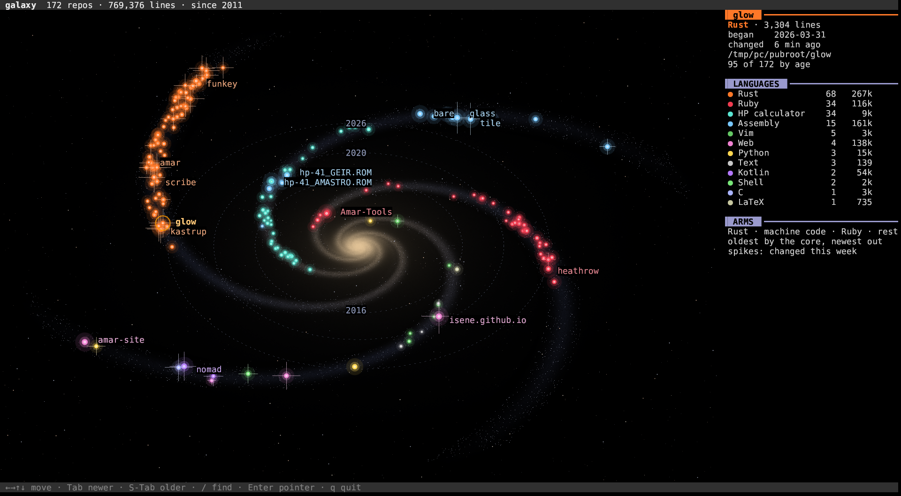

# galaxy


**Your repos as a spiral galaxy in the terminal. Written in Rust.**

    

Every repo in a folder becomes a star. Its size comes from its lines of code and its colour from its main language. The oldest repos sit by the core and the newest at the tips of the arms. A repo changed this week has spikes, and a commit made while galaxy is open makes its star flare. Enter opens the repo in [pointer](https://github.com/isene/pointer). Built on [Crust](https://github.com/isene/crust), part of the [Fe2O3 suite](https://github.com/isene/fe2o3).



Try it in the browser, with my public repos: [isene.org/fe2o3/try/app.html?a=galaxy](https://isene.org/fe2o3/try/app.html?a=galaxy).

In glass, or any terminal that shows images, the sky is real pixels; elsewhere it is drawn in half-block cells.

## Features

- **A star for each repo**: every folder with a `.git` directly under the root. A link to a repo counts too, once
- **Size from the code**: lines counted per language, leaving out build output, vendored code, dot folders and files over 1 MB
- **Colour from the language** with the most lines, 17 told apart, from Rust and Assembly to LilyPond and HP calculator programs
- **An arm per family**: Rust, machine code (Assembly and HP calculator), Ruby, and the rest
- **Age along the arm**: the first commit sets how far out a star sits, with rings marking the years
- **Flares on a commit**: galaxy watches each repo's `.git/logs/HEAD`, measures that repo again when HEAD moves, and lights its star up (Linux)
- **A cache by commit** in `~/.galaxy/cache.tsv`, so a repo is measured again only after a new commit
- **Zero idle cost**: asleep until a key or a commit, no timers, no polling

## Install

Download the binary from [Releases](https://github.com/isene/galaxy/releases), or build from source:

```bash
cargo build --release
cp target/release/galaxy ~/.local/bin/
```

## Usage

```
galaxy [FOLDER]
galaxy --tsv [FOLDER]
```

`FOLDER` is the folder your repos are in. Without it galaxy reads `root = <folder>` from `~/.galaxyrc`, or else uses the current folder. The first start measures every repo on all cores; later starts read the cache. `--tsv` prints each repo's name, lines, language, first and last commit, one per line; the web page draws such a list.

## Key Bindings

| Key | Action |
|-----|--------|
| ← ↑ ↓ → | Move to the nearest star that way |
| Tab, Shift+Tab | The next newer / older repo |
| / | Find a repo by name |
| Enter | Open the repo in pointer |
| q | Quit |

## License

Public domain (Unlicense). Created by [Geir Isene](https://isene.com).
